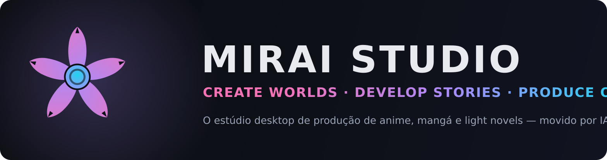
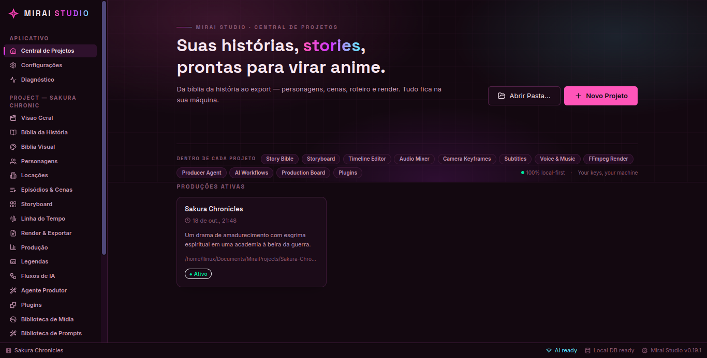
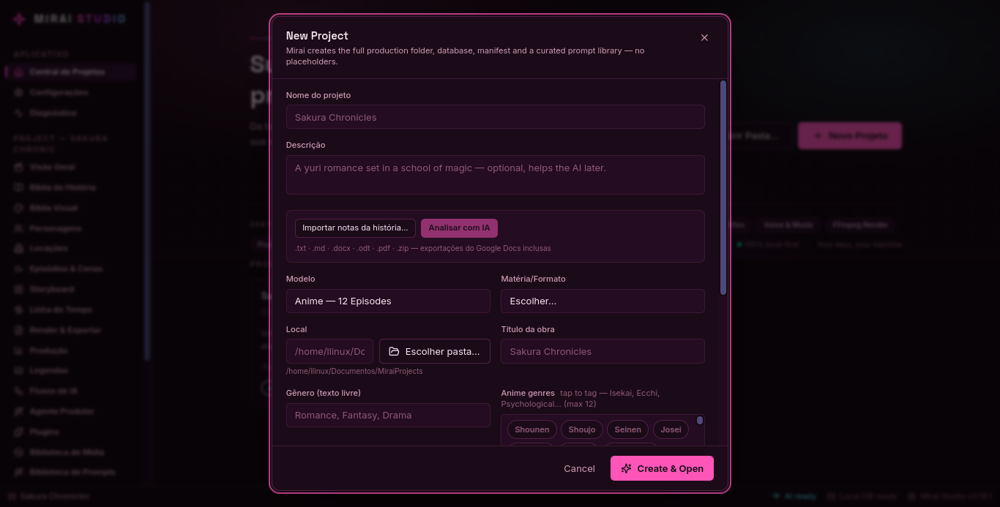
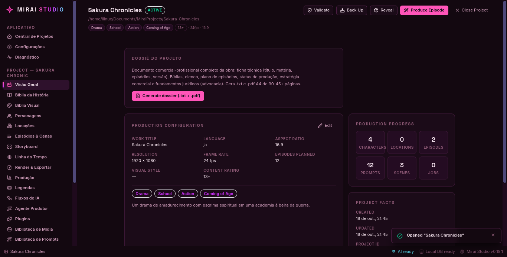
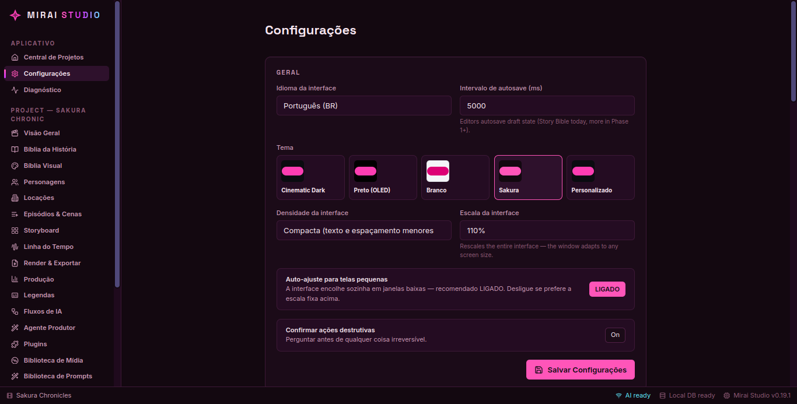
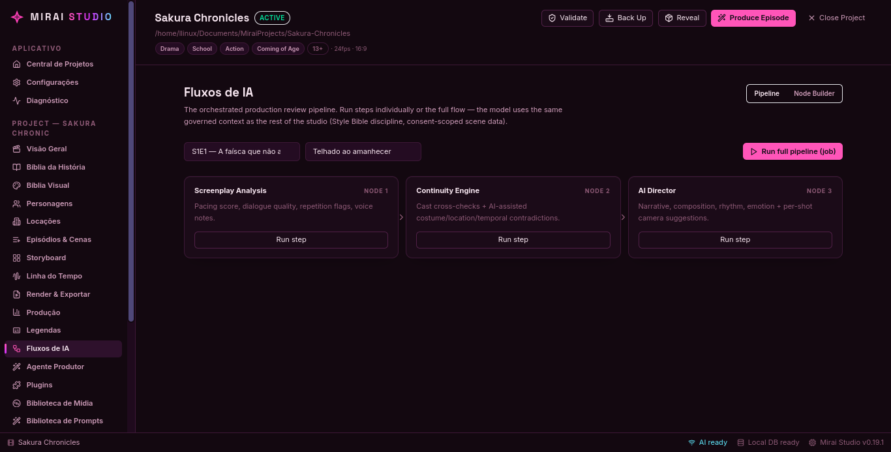

<p align="center">
  
</p>

<h3 align="center">O estúdio desktop completo para criar, desenvolver e produzir IP original — anime, mangá e light novels — com IA e 100% local-first.</h3>

<p align="center">
  <a href="https://github.com/yuaberry/mirai-studio/releases/latest"></a>
  <a href="https://github.com/yuaberry/mirai-studio/actions/workflows/release.yml"></a>
  <a href="#"></a>
  <a href="#"></a>
  <a href="https://yuaberry.github.io/mirai-studio/"></a>
</p>

---

## 🌸 O que é

**Mirai Studio** é um ambiente de produção profissional onde um criador desenvolve uma IP durante todo o ciclo de vida: da primeira ideia — ou do **seu próprio documento** — até a obra estruturada, roteirizada, exportada e pronta para publicação.

Importe seu documento (.txt, .md, .docx, .odt, .pdf, .zip — exportações do Google Docs inclusas) e **a IA adapta a SUA história**: Bíblia da História, personagens, temporada completa e roteiros — com fidelidade total ao documento. Ele é o cânon.

Tudo fica na sua máquina: banco SQLite local, backups reais, chaves de API criptografadas, zero telemetria.

| Project Hub | New Project — notas + brief | Production Overview |
|---|---|---|
|  |  |  |

| Themes (Sakura) | AI Workflows — Node Builder |
|---|---|
|  |  |

---

## ✨ Recursos (todos reais, todos verificados)

### 📖 Story
- **Importe seu documento → a IA adapta a SUA história** (fidelidade-first: o documento é o cânon)
- **Brief do autor**: público-alvo, referências, mundo/época, **temporadas planejadas da IP**, demografia (shounen/seinen/josei…), minutos por episódio ou páginas por capítulo
- Análise profissional de notas com IA (título, premissa, estimativas de temporadas, riscos, notas comerciais)
- **Bíblia da História** e **Bíblia de Estilo** + 3 presets de estilo adulto (Pro)
- Personagens com fichas completas, locações, episódios e cenas com roteiro

### 🎬 Produção
- **Storyboard** com shots, enquadramentos, movimentos de câmera e diálogos
- **Timeline** com keyframes animados, mixer de áudio e câmera por curvas
- **Render real via FFmpeg embutido** (nada para instalar): PREVIEW / MASTER / CINEMA (CRF 14/16), 14 presets de exportação (4K DCI, Cinemascope, 8K, 60fps)
- Geração de **imagem** e **vídeo** (image-to-video) por provedores configuráveis
- **Subtitles Studio**: SRT, VTT e **ASS** (import/export) + burn-in no render
- **Ponte Blender**: anexe .blend a um shot
- **Dossiê do Projeto**: documento comercial-profissional (.txt + **PDF A4 de 30-45+ páginas**) com ficha técnica completa, elenco, plano de episódios, estratégia comercial e **advocacia** (CF, LDA 9.610/98, LGPD, Lei do Audiovisual 8.685/93, Lei Paulo Gustavo 14.216/21)
- **Export EPUB 3 real** — episódios → capítulos de light novel (validado por estrutura: mimetype stored, OPF, nav, spine)

### 🤖 IA
- **Producer Agent**: ideia → episódio completo (bíblia, cast, cenas, shots)
- **AI Director**, **Continuity Engine**, análise de roteiro
- **Node Builder**: monte pipelines visuais de IA (arraste, reordene, execute)
- Provider **NVIDIA NIM** e **OpenRouter** (compatível OpenAI), retry automático em falhas transitórias, orçamento de tokens por chamada, erros sempre com status HTTP
- **Mature Content Mode (Pro)**: toolset adulto com policy **adults-only enforced in code** — chave Ed25519 offline, nada de servidor

### 🏭 Gestão
- Task board kanban com **datas limite + visão Calendário**
- Pipeline de aprovações com auditoria, versionamento de entidades, QC com **12 checks** (inclusive tarefas atrasadas e legendas sobrepostas)
- Analytics de produção, jobs com progresso/cancelamento, plugins com permissões
- **Sessão persistente**: reabre seu último projeto na última página; **5 temas** (Dark, Preto OLED, Branco, Sakura, **Personalizado** com cor de destaque sua) · pt-BR completo

---

## 📦 Baixe (6 plataformas, construídas por CI em runners reais)

[](https://github.com/yuaberry/mirai-studio/releases/latest)

| Plataforma | Arquivo |
|---|---|
| 🪟 **Windows** | `mirai-studio_x.y.z_x64-setup.exe` |
| 🍎 **macOS** (Apple Silicon) | `mirai-studio_x.y.z_arm64.dmg` |
| 🐧 **Linux** Debian/Ubuntu/Mint | `mirai-studio_x.y.z_amd64.deb` |
| 🐧 **Linux** portátil | `mirai-studio_x.y.z_x86_64.AppImage` |
| 🐧 **Linux** Fedora/RHEL | `mirai-studio_x.y.z_x86_64.rpm` |
| 📱 **Android** — *Mirai Companion* | `mirai-companion-x.y.z.apk` |

> FFmpeg (GPL) vai embutido em todos os desktops — render funciona sem instalar nada. macOS sem assinatura Apple: botão direito → Abrir na primeira vez.

**Mirai Companion** (Android): leia o **Dossiê do Projeto** no celular — compartilhe o `.txt` do desktop e continue lendo em qualquer lugar, 100% offline.

---

## 🏗️ Arquitetura (o que faz tudo isso real)

```
apps/desktop   Electron + React + Tailwind — renderer, main (IPC tipada por contratos zod)
apps/mobile    Capacitor + React — companion Android (leitor de dossiê)
packages/core  Domínio: SQLite (migrations versionadas), render FFmpeg, QC,
               dossiê (pdfWriter A4 próprio), EPUB 3 (zipWriter próprio),
               notas (leitor zip/docx/odt/pdf próprio, zero dependências)
packages/ai    Providers (OpenAI-compat): chat, imagens, vídeo, SSE
packages/shared Schemas zod — o contrato entre tudo
```

- **Contratos IPC tipados ponta a ponta** (zod): nenhum canal solto
- **197 testes + 50 passos de smoke E2E** (FFmpeg real, EPUB real, adaptação real de documento com transport scriptado, ABI verificado nos pacotes)
- **CI em 5 jobs** (ubuntu, windows, macos, android, publish) — cada plataforma construída no SO nativo dela

## 🗺️ Roadmap

Feito: 🟢 story+adaptação de documentos · dossiê+advocacia · EPUB · render FFmpeg · temas · multi-plataforma · companion móvel
Próximo: 🔵 editor de páginas de mangá (painéis/lettering/RTL) · export DOCX/PDF de light novel · grafo de IPs e telas de impacto

## 🌸 Criação

Feito com dedicação pela **Yua Devs** — *create worlds, develop stories, produce original IP.*

> A IA é uma ferramenta de produção sob direção humana. O conteúdo adulto é regido por policy adults-only enforce em código: o app é um estúdio de histórias, não um gerador de conteúdo adulto.
